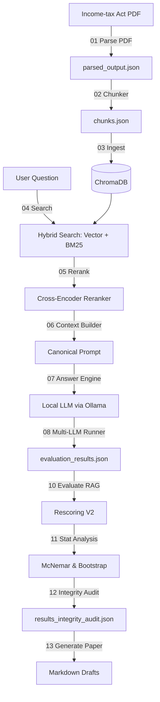

# TAXITIQ

> A local, corpus-grounded legal Retrieval-Augmented Generation system for the Income-tax Act 2025.

[](#license)
[](#current-project-phase)

TAXITIQ is an experimental legal AI system designed to answer questions using evidence retrieved directly from India's **Income-tax Act, 2025**.

---

## What is TAXITIQ?
TAXITIQ is a fully local Retrieval-Augmented Generation (RAG) system. Retrieval-Augmented Generation means the AI does not try to answer questions from its memory. Instead, it acts like an open-book student: it searches a database of legal documents, finds the correct laws, and uses them to write its answer.

## The Simple Idea
The project began with a simple question:
**Can a fully local RAG system answer legal questions while showing exactly where its evidence came from?**

## Why This Project Exists
In high-stakes domains like tax law, AIs cannot be allowed to make mistakes ("hallucinate"). TAXITIQ was created to build a strictly grounded, fully local pipeline where every answer can be traced back to a specific legal provision, running entirely on consumer hardware without sending private data to cloud services.

## The Research Question
As the project evolved, our central research question became:
**When retrieval, reranking, context, and prompts are kept identical, how much does the choice of local LLM change the final answer?**

## What Makes TAXITIQ Different?
Unlike standard AI systems, TAXITIQ separates searching from writing. It freezes the search components so that both evaluated models get the exact same text contexts and prompts, letting us isolate the generator model's answer behavior.

### Key Concepts Explained for Beginners

- **Retrieval-Augmented Generation (RAG)**: An "open-book" system where the AI searches a custom database of files first, retrieves the relevant laws, and feeds them to the LLM to write the answer.
- **Why Hybrid Search (Vector + BM25) is used**: Vector search finds general semantic concepts, while BM25 keyword search matches exact terms, codes, and numerical section numbers. Combining them ensures we do not miss exact legal citations.
- **What Reranker does**: The reranker re-evaluates the search results and puts the most relevant chunks at the very top of the context window.
- **Percentage Points vs Percentages**: A percentage point is the simple difference between two percentages (e.g., Qwen3's 71.67% success rate minus Qwen2.5's 43.33% success rate equals an absolute gain of 28.33 percentage points).
- **McNemar's Test**: A statistical test used to verify if the performance gap between Qwen2.5 and Qwen3 is statistically significant or if it could have happened by random chance.
- **CORPUS_GROUNDED**: This status means the evaluation benchmark only uses questions whose answers are fully grounded in the Income-tax Act 2025 corpus.
- **AUTO_GROUNDED**: This status means the answers are scored using automatic, deterministic code rules rather than manual validation by human legal experts.

---

## Pipeline Diagram



## Pipeline Step-by-Step
1. **Parsing**: Layout text is read page-by-page from the PDF.
2. **Chunking**: The text is split into 4,123 small section chunks.
3. **Ingestion**: Chunks are embedded and stored in a persistent local vector database.
4. **Hybrid Retrieval**: Queries vector and keyword indices to fetch the top 30 candidate chunks.
5. **Reranking**: Uses a cross-encoder to sort the candidate chunks by relevance.
6. **Context Builder**: Combines the top 8 chunks to build the prompt context.
7. **Generation**: The local LLM writes the answer referencing the context.

---

## Project Journey / History
- **Phase 1-4**: Initial PDF parsing, ChromaDB setup, and local retrieval indexing.
- **Phase 5-8**: Controlled multi-LLM execution run on Qwen2.5 and Qwen3.
- **Phase 9-10**: Bug discovery in the scoring counts resolved with the `INDIALAWRAG_SCORING_V2` update.
- **Phase 11-13**: McNemar statistical testing, 10,000-resample paired bootstrap CI, and results integrity audit.

## Current Project Phase
We are currently in **Phase 14A: Repository Organization and Documentation**. The pipeline is frozen for reproducibility.

## Repository Structure
Please refer to [PROJECT_STRUCTURE.md](docs/PROJECT_STRUCTURE.md) for details.

## Technology Stack
- **Languages**: Python, PowerShell
- **Database**: ChromaDB (local vector storage)
- **Deep Learning**: PyTorch, Transformers, SentenceTransformers
- **Inference**: Ollama (local model server)
- **Visualizations**: Matplotlib

## Models Used
1. **Embeddings**: `BAAI/bge-large-en-v1.5`
2. **Reranker**: `BAAI/bge-reranker-v2-m3`
3. **Generators**: `qwen2.5:7b-instruct` and `qwen3:8b`

## Dataset and Corpus
- **Source**: Income-tax Act, 2025 (amended by Finance Act, 2026).
- **Size**: 4,123 deterministic chunks.

## Evaluation Benchmark
The IndiaLawRAG v2 benchmark has **60 questions** stratified into:
- **SUPPORTED** (55 questions): Context is in the corpus.
- **NOT_SUPPORTED** (5 questions): Out-of-corpus queries.
- Formulations: **LEXICAL** (8), **PARAPHRASED** (47), and **REASONING** (5).

## Controlled Experiment Design
Upstream retrieval and context are completely frozen. Both models receive identical inputs, isolating the generator model's answer coverage and refusal behaviors.

---

## Scoring V2 Explained Simply
We grade success under the `INDIALAWRAG_SCORING_V2` policy. An answer is marked as successful if it is free of hard failures (empty texts, refusals on supported questions, citation or numeric hallucinations) and scores $\ge 0.50$ on content coverage.

## Final Experimental Results
- **Qwen2.5 7B Success Rate**: **43.33%** (26/60) | 95% CI: `[31.67%, 56.67%]`
- **Qwen3 8B Success Rate**: **71.67%** (43/60) | 95% CI: `[60.00%, 83.33%]`
- **Absolute Gain**: **28.33 percentage points** | 95% CI: `15.00 to 41.67 percentage points`

## Statistical Significance
The difference is statistically significant (exact McNemar p = `0.000221`, continuity-corrected Chi-Square = `12.1905`, corrected p = `0.000480`). This means the performance gap is highly unlikely to be due to chance.

## Failure Attribution
- **Qwen2.5**: Primarily failed due to high supported-question refusals (refused **50.91%** of supported questions despite having evidence).
- **Qwen3**: Refused only **7.27%** of supported questions, but experienced 1 citation and 1 numeric grounding failure (both on Question Q18).

## Assessment Year Case Study
Question Q52 and Q55 outcomes:
- **`Q52`**: Successfully answered by Qwen2.5, but Qwen3 suffered a citation grounding failure.
- **`Q55`**: Qwen2.5 refused the question, while Qwen3 failed content coverage limits (coverage score was `0.4579` < `0.50`).

---

## Requirements & Hardware Notes
TAXITIQ can run on CPU. A compatible GPU may improve embedding, reranking, or local model performance, but GPU/CUDA is not required for the evaluated pipeline.

Runs entirely locally. Recommended hardware:
- GPU with $\ge 12$ GB VRAM (for Qwen3 8B inference).
- 16 GB system RAM.

### Runtime Dependencies Notes:
- **PyTorch**: Used by the Python ML components (embedding generation and cross-encoder reranking). PyTorch is installed via `pip` from `requirements.txt`.
- **Ollama**: Manages the local Qwen LLM generator execution separately as an independent local service process. Ollama installation and execution setup are not provided by `pip requirements.txt`. Refer to the installation guide below.

## Installation Guide (Windows)

### 1. Python Environment Setup
```powershell
python -m venv venv
.\venv\Scripts\Activate.ps1
pip install -r requirements.txt
```

### 2. Ollama Installation & Download Models
Download Ollama from [ollama.com](https://ollama.com). In PowerShell, run:
```powershell
ollama pull qwen2.5:7b-instruct
ollama pull qwen3:8b
```

---

## How to Execute the Pipeline

### Parse PDF
```powershell
python 01_parse_pdf.py
```

### Create Chunks
```powershell
python 02_chunker.py
```

### Ingest Chunks
```powershell
python 03_ingest.py
```

### Test Retrieval
```powershell
python 04_search.py
```

### Run Reranking
```powershell
python 05_reranker.py
```

### Test Answer Generation
```powershell
python 07_answer_engine.py
```

---

## Running the Multi-LLM Benchmark

### Validate Dataset
```powershell
python 10_evaluate_rag.py --validate-dataset
# Or using PS1 helper:
.\scripts\validate_dataset.ps1
```

### Run Full Benchmark
```powershell
python 10_evaluate_rag.py --run
# Or:
.\scripts\run_evaluation.ps1
```

### Resume Interrupted Benchmark
```powershell
python 10_evaluate_rag.py --resume
# Or:
.\scripts\resume_evaluation.ps1
```

### Offline Rescoring V2
```powershell
python 10_evaluate_rag.py --rescore
# Or:
.\scripts\rescore.ps1
```

### Run Statistical Analysis
```powershell
python 11_statistical_analysis.py
# Or:
.\scripts\run_statistics.ps1
```

### Verify Paper Results (Audit)
```powershell
python 12_results_integrity_audit.py
# Or:
.\scripts\verify_results.ps1
```

### Generate Paper Artifacts
```powershell
python 13_generate_paper_artifacts.py
# Or:
.\scripts\generate_paper_artifacts.ps1
```

---

## Output Files
See [PROJECT_STRUCTURE.md](docs/PROJECT_STRUCTURE.md) for details.

## Reproducibility & Hashes
Refer to [REPRODUCIBILITY.md](docs/REPRODUCIBILITY.md).

## Limitations & Claim Boundaries
- Evaluated on a single legal corpus (Income-tax Act, 2025).
- Benchmark is corpus-grounded (`CORPUS_GROUNDED`) and auto-grounded (`AUTO_GROUNDED`).
- Does not represent human professional validation or expert audit.
- Central findings Suggest model choice is associated with performance differences under identical contexts.

## Future Roadmap
- Expert human evaluation and structured output enforcement.
- Integration of proprietary cloud models for comparative baseline study.

## Contributing
Please raise an issue or pull request to discuss modifications.

## Repository Safety / Large Files
Heavy database directory `chroma_db/`, runtime log files `logs/`, and rules PDF are gitignored.

## License
Refer to [LICENSE_REVIEW.md](LICENSE_REVIEW.md) for licensing options prior to final release.

## Author / Project Context
Developed by Mukul Ghai for India legal RAG research.
